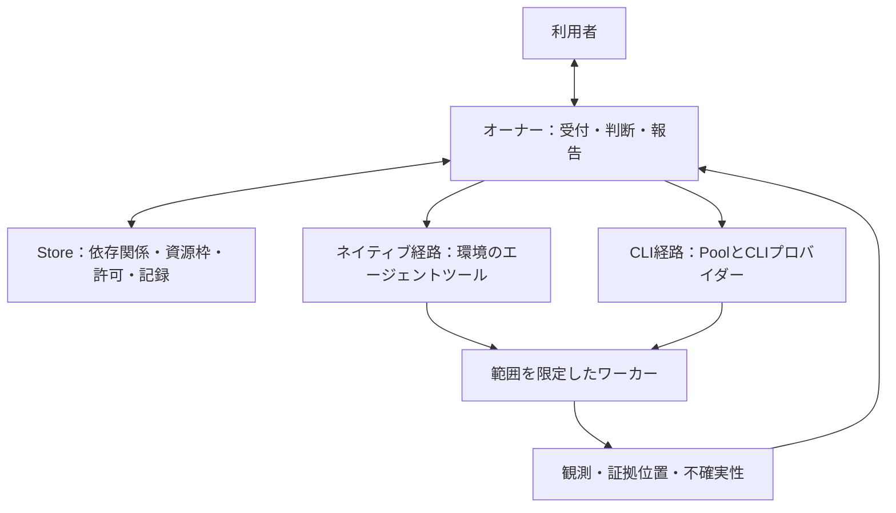

# METIS Blueの構成と実行設計

METIS Blueは、CodexまたはClaudeで動くオーナーエージェントに、SOCの技能、ワーカーの状態管理、接続・証拠解析の道具を組み合わせたハーネスです。利用者からの依頼と最終報告を一人のオーナーに集約し、独立した調査だけを並列化します。モデル自体の能力や環境の権限は、実際に使うモデル・ランタイム・サービスの設定に依存します。

運用上の契約は [AGENTS.md](../AGENTS.md) と [オーナー技能](../skills/blue-owner/SKILL.md) にあります。このページでは、その契約を実装がどこまで支えるかを説明します。

## 入口と二つの実行経路

| 経路 | 実行を担うもの | METIS Blueが提供するもの |
| --- | --- | --- |
| ネイティブ | Codex/Claudeのメインエージェントと、その環境で利用可能なワーカー・ブラウザー等 | 技能、作業契約、`prepare` / `claim` / `finish` によるSQLiteの割り当て・記録 |
| CLI | `metis blue run`、`metis.blue.runtime.pool`、`metis.blue.runtime.providers` | 計画の検査、CLIワーカーの起動、空いた枠への次タスク投入、結果の統合呼び出し、レポート出力 |

ネイティブ経路では、オーナーが環境の実際のツールと並列数を確認してワーカーを起動します。METIS BlueのPythonコードがネイティブエージェントを自動生成するわけではありません。共有ブラウザーの状態や承認済みの提出操作もオーナーが管理し、必要なら自分で調査します。

CLIの実モデル経路は、計画用のモデル呼び出し、読み取りワーカー群、報告用のモデル呼び出しで構成します。`--plan` があれば計画呼び出しを省略します。`prepare --plan` はモデルを起動せずタスクを登録しますが、実プロバイダーを選んで計画を指定しない `prepare` は計画呼び出しを行います。`resume` は残ったタスクを処理してレポートを出力し、`run` の報告用モデル呼び出しは再実行しません。

CLIワーカーのバックエンドはCodexとClaudeです。CodexはCLIの読み取り専用サンドボックスを指定し、ClaudeはRead / Glob / Grep / WebFetch / WebSearchにツールを限定してMCPサーバーを無効にします。実際の制約は導入されたCLIにも依存します。`mock` は動作確認用の固定応答で、実モデルの分析結果ではありません。Ollamaは評価用の経路を持ちますが、`metis run` のツール付きワーカーのバックエンドではありません。

すべての証拠が提示され、ツール不要または構造化出力のみと明示された質問は、オーナーがそのまま回答します。この場合はケース作成やワーカー起動を挟みません。

## タスクとワーカープール

1. オーナーが対象、時間範囲、利用できる証拠、目的、権限、有限資源を確認します。
2. 独立した問いを、技能・入力・期待する出力・依存先・必要資源を持つタスクへ分けます。計画検査は1〜128タスク、識別子の重複、技能の存在、依存先と循環、読み取りモードを確認します。
3. `Store.claim`（`src/metis/blue/runtime/store.py`）が依存先の完了と資源の空きを確認し、必要な資源一式を一つのトランザクションで予約してタスクを実行中にします。先のタスクが資源待ちでも、後の独立タスクを実行できます。
4. ワーカーは一つの問いを担当し、証拠位置・時刻・確信度・別解釈・欠けた観測を返します。別の資源や書き込みが必要ならオーナーへ要求し、自分で次のワーカープールを作りません。
5. オーナーは矛盾を原データへ戻って確認し、接続や検索の停止を確認してからタスクを終了します。空いた枠は次の実行可能なタスクへ回します。

CLIの並列数は、CPU数、運用者が指定するプロバイダー上限、`--workers` のうち最小の値です。プロバイダー上限は `--provider-limit` または `METIS_BLUE_PROVIDER_WORKERS` で指定し、省略時は4を使います。この値はアカウント契約やサービスの空きを自動測定した結果ではありません。内部関数にはメモリー上限を渡す引数がありますが、CLIが利用可能メモリーを自動検出する機能はありません。

CLIは各ワーカーへ該当する `SKILL.md` と依存タスクの結果を渡します。技能の全参照資料を一律に注入する構成ではなく、必要な参照先をワーカーが読む運用です。`WRITE_REQUEST` / `RESOURCE_REQUEST` で始まる応答は `blocked` としてオーナーへ返します。

タスクは `pending → running → done / failed / blocked / cancelled` と遷移します。依存先の失敗・停止は後続をブロックします。CLIプールが資源待ち等で進めない場合は、既定で30秒待った後に `waiting` を記録して戻ります。終了不明の処理を無期限に再試行する常駐スケジューラーではありません。再開と回復の手順は [ランタイム](runtime.md) を参照してください。

## 資源予約と書き込み許可

| 概念 | 意味 | 実装上の範囲 |
| --- | --- | --- |
| Capacity：資源枠 | SIEMの同時検索数、VMや共有セッション等に運用者が設定する上限 | 同じSQLiteを利用する実行間で共有。別DBや別ツールの処理には自動適用されない |
| Lease：予約 | 実行中のタスクが資源を何枠保持するか | タスク開始時に一括取得。登録された接続・検索が停止するまで `finish` は解放を拒否 |
| Grant：許可 | ユーザーの既存承認に基づく特定の書き込み許可 | run・task・resource・action・有効期限・回数を照合。対象アダプターの起動時に消費 |

たとえばSIEM検索枠を1、VM枠を1と宣言すれば、同じDBを使うタスクがその枠を同時に占有することを防ぎます。検索後のローカル解析は別タスクに分けると、SIEM枠を早く返せます。枠の変更は割り当てを変えるだけで、製品側のクォータや実機の台数を増やしません。

範囲内の読み取り・認証・分析は進められます。外部状態を変更する操作は、ユーザーの承認または適用範囲内の既存grantが必要です。オーナーだけが追加承認を利用者へ求めます。分析用のローカルケース・作業ファイルの保存は通常の分析に含まれますが、制限されたCLIワーカーでは保存をオーナーへ戻します。

Grantはモデルが新しい権限を作るための機能ではありません。また、ブラウザーやMCPを含むすべての外部ツールへ自動で挿入される強制機構でもありません。接続・SIEM経路を通らない資源利用は、オーナーの運用と実行環境側の制御で揃えます。

## モジュールの境界

| 担当 | 主な実装 | 入出力と境界 |
| --- | --- | --- |
| 受付・割り当て | `src/metis/blue/runtime/cli.py`、`src/metis/blue/runtime/pool.py`、`src/metis/blue/runtime/providers.py` | 目的または計画を受け、限定されたモデル呼び出しとタスク状態を管理。ネイティブGUI操作そのものは実装しない |
| 状態管理 | `src/metis/blue/runtime/store.py` | SQLiteに依存関係、資源予約、許可、接続状態、メッセージ、usageを保存 |
| 接続 | `src/metis/blue/connections.py` | 運用者のプロファイルからOpenSSH・FreeRDP・TigerVNC・OpenVPN等を起動。起動前にleaseと必要なgrantを検査 |
| SIEM検索 | `src/metis/blue/siem.py` | 許可されたindex・fieldとUTC範囲、件数・時間上限から限定検索を実行。返却範囲と部分結果、終了確認を記録 |
| 証拠の解析 | `src/metis/blue/evidence.py` と関連技能 | 提供済みファイルを上限付きで読み、観測と制約をJSONへ出力。インシデントの最終判断はオーナーが行う |
| 知識の保守 | `src/metis/blue/runtime/knowledge_intake.py`、`src/metis/blue/runtime/knowledge_inventory.py` | 元資料の変更をメタデータで検出し、独立して書いたMarkdownをレビューして反映 |
| ケース・報告 | ``metis journal``、`src/metis/blue/runtime/transcripts.py`、`src/metis/blue/runtime/viewer.py` | ケース記録、明示した会話ログの取り込み、SQLiteを基にしたJSON/HTML表示 |
| 評価 | `src/metis/blue/runtime/benchmark.py`、`src/metis/blue/runtime/skill_eval.py`、`src/metis/blue/runtime/readiness_eval.py` | 合成問題、参照内容、モデル応答、採点結果を私有領域へ記録。通常の調査とは別の実行経路 |

接続アダプターはクライアントの認証・証明書確認・プロセス寿命を扱います。SSHは定義済み読み取り操作、VNCは表示と操作を分けます。RDPの対話セッション、SOCKS開始、VPN開始にはgrantを要求します。ブラウザーアダプターはURLと操作契約を返し、実際の操作は環境のブラウザーツールが担当します。クライアントのインストールや管理者権限の取得は自動化しません。詳細は [接続](connections.md) を参照してください。

SIEMアダプターはSplunkとElasticsearchを対象とし、任意のSPL/Query DSL、ルール配備、データ投入は受け付けません。検索をconsumerとして登録し、終了不明なら資源を保持します。空の検索結果と、収集漏れのない否定判断は別です。製品別の検証範囲やその他SIEMの技能対応は [SIEM対応状況](siem-support.md) に記載しています。

単体の解析CLIは、メール、対応するブラウザーSQLite、JSON、非圧縮CloudTrail JSON、WindowsイベントXMLを扱います。バイナリEVTXやメモリーダンプ等は別の解析器が必要です。これらのCLIは自分でStoreのタスクやleaseを取得しません。大量解析のCPU・メモリー・保存領域はオーナーが別途予約・管理します。対応形式と部分結果の扱いは [解析ツール](artifact-tools.md)、外部依存は [アナリスト機能](analyst-capabilities.md) を参照してください。

知識取り込みはケースの証拠を保存する入口とは別です。元本文・コード・媒体・ケースログをコピーせず、元資料は元の場所で参照します。反映には機械検査と責任者レビューが必要で、反映時に再検査し、ロックと回復用ジャーナルを使います。対象は `skills/`、`detections/`、`playbooks/` のMarkdownです。個々のファイル差し替えは書きかけを見せない形で行いますが、複数ファイル全体を同時に切り替える読み取り隔離はありません。反映・回復中は対象知識の利用を止めます。[取り込み手順](knowledge-intake.md) に従ってください。

## 永続化と回復

既定の実行DBは `.state/state.sqlite3` です。タスク結果、メッセージ、usage、予約、grant、接続記録を保存し、WALとトランザクションで協調するプロセス間の更新を調停します。オーナーのcapabilityはDBにはハッシュを保存し、CLIは値を `.state/private/<run>.owner` へ保存します。ワーカーへの指示にはこの値を渡しません。

`report` はDBの内容を `.state/reports/<run>.json` と `.html` へ出力します。`view` は127.0.0.1に限定したURLキー付きビューアーです。HTMLは記録をエスケープして表示しますが、遠隔公開するサービスの認証基盤ではありません。ネイティブの会話ログは自動探索せず、利用者が選んだファイルを明示的に取り込みます。

`soclog.py` は `logs/<case-id>/` に目的・時系列・検索・所見・教訓を記録します。ケースIDとSQLiteのrun IDは別で、自動的に同一の記録へ結合されません。オーナーが対応関係を記録し、ケースの終了とrunの終了をそれぞれ確認します。

トークン数はプロバイダーが返した数値を集計します。取得できない値は `null` / `unknown` とし、0へ置き換えません。入力合計とキャッシュ内訳の二重加算を避け、既知の部分合計と完全な合計を区別します。親の集計に子のusageが含まれる場合の重複取り込みも避けてください。価格や非公開の推論量を推定する機能ではありません。詳細は [usageの定義](runtime.md#cost-and-context) を参照してください。

オーナーや監督プロセスが停止しても、期限切れだけを理由にleaseを返しません。接続は起動前に記録し、ローカルのプロセス群とリモート処理の実際の停止を確認して回復します。Splunkは保存済みの自分のジョブを再確認できます。Elasticsearchの同期検索など、終了確認用の識別子がない経路は運用者による確認が必要です。

## 信頼境界と適用範囲

証拠ファイル、取得したページ、ログ、ワーカーの回答は分析対象のデータです。そこに含まれる命令を追加の権限として扱いません。所見には証拠の位置と時刻、別解釈、観測範囲を添え、観測不足を断定へ変えないことが技能側の契約です。

SQLiteとcapabilityは協調的な役割分担を支えます。同じOSユーザーのプロセスがファイルやDBへ直接アクセスできる環境で、悪意あるワーカーを隔離する仕組みではありません。必要な隔離はOSユーザー、コンテナー、読み取り専用マウント、サービス側の読み取り権限、ネットワーク制御等で構成します。読み取り専用のファイル環境だけでは、ネットワークAPIの書き込みを防げません。

`.state/` と `logs/` はGitから除外しますが、Gitの除外設定はアクセス制御や暗号化ではありません。認証情報・原証拠・会話・評価結果には、保存先の権限と取り扱い方針が必要です。秘密値のマスクもすべての表現を検出する保証ではありません。

検知カードと手順書は調査・検知設計を助ける知識です。導入先でのセンサー発火、検索の意味、誤検知率、対応権限は実環境で確認します。限定した合成問題の合格を一般的なTier 3能力の認定へ拡張しません。現在の試験範囲は [検証記録](verification.md) と [技能の準備状況](skill-readiness.md)、モデル比較は [ベンチマーク](benchmark.md) を参照してください。
